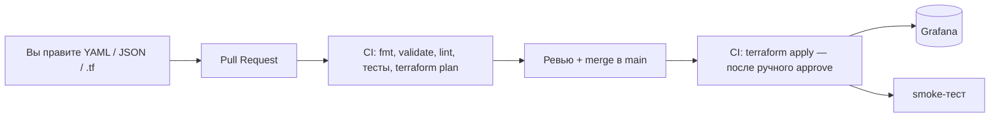

# Grafana as Code — тестовый стенд и эталонный репозиторий

Проверяем подход **«Git — единственный источник правды»**: датасорсы, папки, дашборды, алерты, контактные точки и маршрутизация уведомлений описаны кодом (Terraform + YAML + JSON). Поменял файл → Pull Request → проверки → merge → CI применил изменения в Grafana.



Это **учебный стенд для ручной проверки**, а не продакшн. Всё поднимается локально одной командой.

---

## С чего начать (маршрут на 1 страницу)

| Шаг | Что сделать | Где подробно |
|---|---|---|
| 1 | Прочитать, что вообще происходит (10 минут) | [docs/00-overview.md](docs/00-overview.md) |
| 2 | Установить Docker Desktop, Git, Terraform, make | [docs/01-prerequisites.md](docs/01-prerequisites.md) |
| 3 | Поднять стенд: `make up` | [docs/02-start-stand.md](docs/02-start-stand.md) |
| 4 | Первый `make init && make apply` — всё появится в Grafana | [docs/03-first-apply.md](docs/03-first-apply.md) |
| 5 | Добавить свой алерт через YAML и увидеть уведомление | [docs/04-tutorial-add-alert.md](docs/04-tutorial-add-alert.md) |
| 6 | Нарисовать дашборд в UI и положить его в Git | [docs/05-tutorial-add-dashboard.md](docs/05-tutorial-add-dashboard.md) |
| 7 | Настроить GitHub Actions (секреты, раннер, approve) | [docs/06-ci-setup.md](docs/06-ci-setup.md) |
| 8 | Понять, почему нельзя править руками в UI | [docs/07-drift-and-rules.md](docs/07-drift-and-rules.md) |
| 9 | Потренироваться | [docs/09-exercises.md](docs/09-exercises.md) |
| — | Что-то сломалось? | [docs/08-troubleshooting.md](docs/08-troubleshooting.md) |
| — | Шпаргалка команд и чек-лист «перед PR» | [docs/10-cheatsheet.md](docs/10-cheatsheet.md) |

### Быстрый старт (если всё уже установлено)

```bash
cp .env.example .env     # один раз; в PowerShell: Copy-Item .env.example .env
make up                  # стенд: Grafana, Prometheus, MinIO, приёмник вебхуков ... (~1 мин)
make init                # terraform init (подключает state в MinIO)
make plan                # посмотреть, что будет создано
make apply               # создать всё в Grafana (спросит yes)
make test                # проверки кода + smoke + сквозной тест алерта (~2,5 мин)
make alert-fire          # вызвать тестовый алерт руками и увидеть уведомление
make alert-resolve       # снять алерт
```

Нет `make`? Те же команды без него — в [docs/10-cheatsheet.md](docs/10-cheatsheet.md).

---

## Адреса и логины стенда

| Что | Адрес | Логин / пароль (по умолчанию, из `.env`) |
|---|---|---|
| Grafana | http://localhost:3000 | `admin` / `admin12345` |
| Prometheus | http://localhost:9090 | — |
| Приёмник вебхуков (обычные уведомления) | http://localhost:8081/s/aaaaaaaa-aaaa-4aaa-8aaa-aaaaaaaaaaaa | — |
| Приёмник вебхуков (critical) | http://localhost:8081/s/cccccccc-cccc-4ccc-8ccc-cccccccccccc | — |
| MinIO (S3 для state), консоль | http://localhost:9001 | `minioadmin` / `minioadmin123` |
| Pushgateway (генератор тестовых метрик) | http://localhost:9091 | — |
| node-exporter | http://localhost:9100/metrics | — |

Порты слушают только `127.0.0.1` (с вашего компьютера). Пароли — только для локального стенда.

## Структура репозитория

```
.
├── docker-compose.yml        # стенд: все сервисы, версии зафиксированы
├── .env.example              # настройки стенда (копируется в .env, который в .gitignore)
├── Makefile                  # make up / plan / apply / test / alert-fire ...
├── alerts/                   # АЛЕРТЫ ДАННЫМИ: один YAML = одна группа правил. Джуниор правит это.
├── dashboards/               # ДАШБОРДЫ JSON: подкаталог = папка в Grafana
├── terraform/
│   ├── envs/test/            # точка входа: backend, провайдер, вызовы модулей, версии
│   └── modules/
│       ├── datasource-prometheus/   # датасорс
│       ├── dashboards/              # папки + дашборды из dashboards/
│       ├── alert-rules/             # YAML из alerts/ -> правила (+ проверки и тесты)
│       ├── notifications/           # contact points, notification policy, mute timings, шаблон
│       └── access/                  # команда + права на папки (View для Editor/Viewer)
├── scripts/                  # bootstrap, smoke, e2e-проверка алерта, валидатор дашбордов, drift-демо
├── stand/prometheus/         # конфиг Prometheus для стенда
├── docs/                     # документация и учебные материалы (на русском)
└── .github/workflows/        # pr-checks.yml, apply.yml, drift.yml
```

**Почему так (отличия от минимального задания):**
* `alerts/` и `dashboards/` лежат в корне, а не внутри `terraform/` — их правят чаще всего и не-терраформисты; `terraform/` трогают редко.
* Модули маленькие и «плоские»; вся склейка — в `terraform/envs/test/main.tf` (читается сверху вниз как оглавление).
* Скрипты написаны на **Python (только стандартная библиотека)** и запускаются **внутри контейнера** (`make ...`), а не на Windows-хосте: так не нужны ни установленный Python, ни `curl`/`jq`. POSIX sh тут не подошёл — нужен разбор JSON и подпись S3-запросов (SigV4) для создания бакета.
* Добавлен модуль `access`: «нельзя править руками» держится не только на provenance (он есть только у алертов), но и на правах папок (см. [docs/07](docs/07-drift-and-rules.md)).

## Terraform state и MinIO

Terraform хранит «что уже создано» в файле **state**. На стенде он лежит не на диске, а в бакете `tfstate` сервиса **MinIO** (S3-совместимое хранилище) — чтобы показать удалённый state и **блокировки** (два одновременных `apply` не пройдут). Бакет создаётся автоматически (`scripts/bootstrap.py`), версионирование включено.

**В бою MinIO не будет.** Вместо него — ваш настоящий backend (S3/GCS/Azure Blob, GitLab, Terraform Cloud…) с отдельным пользователем и шифрованием. Меняется только блок `backend "s3"` в `terraform/envs/test/versions.tf` и переменные окружения; остальной код остаётся прежним. Адрес и ключи хранилища в код не зашиты — они приходят из переменных окружения (`AWS_ENDPOINT_URL_S3`, `AWS_ACCESS_KEY_ID`, `AWS_SECRET_ACCESS_KEY`).

## Версии (всё зафиксировано, `latest` нигде нет)

| Компонент | Версия | Где задана |
|---|---|---|
| Grafana OSS | `12.2.0` | `docker-compose.yml` |
| Prometheus | `v3.5.0` | `docker-compose.yml` |
| node-exporter | `v1.9.1` | `docker-compose.yml` |
| Pushgateway | `v1.11.1` | `docker-compose.yml` |
| webhook-tester (приёмник вебхуков) | `2.3.0` | `docker-compose.yml` |
| MinIO | `RELEASE.2025-04-22T22-12-26Z` | `.env.example` / `docker-compose.yml` |
| Python в контейнерах `bootstrap`/`tools` | `3.13.16-alpine3.23` | `docker-compose.yml` |
| Self-hosted runner (профиль `ci`) | `myoung34/github-runner:2.337.0-ubuntu-noble` | `docker-compose.yml` |
| Terraform | `1.16.5` (требуется `>= 1.11`) | `terraform/envs/test/.terraform-version`, `required_version` |
| Провайдер `grafana/grafana` | `4.49.0` (точно) | `versions.tf`, `.terraform.lock.hcl` |
| tflint | `v0.63.1` | `.github/workflows/pr-checks.yml` |
| yamllint | `1.37.1` | `.github/workflows/pr-checks.yml` |
| GitHub Actions | закреплены по SHA коммита | `.github/workflows/*.yml` |

## Что проверено, а что нет

Подробный отчёт — в конце [docs/00-overview.md](docs/00-overview.md#что-проверено-на-самом-деле-и-что-нет). Коротко: стенд, Terraform, алерты с доставкой, drift, state-lock и статические проверки CI запущены и проверены на Linux с Docker. **Не проверялось:** запуск на Windows 11, реальные GitHub Actions (в т.ч. self-hosted раннер), UI Grafana глазами.

## Безопасность

* `.env`, `.secrets/` (токен Terraform), `*.tfstate`, `*.tfvars` — в `.gitignore`. В Git секретов нет.
* Пароли в `.env.example` — **учебные**. Не используйте их нигде, кроме локального стенда.
* Self-hosted раннер выполняет код из PR — не подключайте его к публичному репозиторию с PR из форков (workflow это блокирует условием, но лучше не рисковать).
