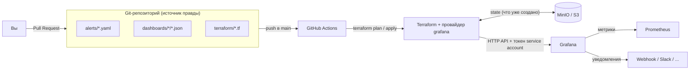

# 00. Обзор: что это и зачем

## Идея в трёх предложениях

Раньше: открыл Grafana в браузере → накликал дашборд → накликал алерт. Через месяц никто не помнит, кто и зачем это менял, а при поломке всё надо кликать заново.

Теперь: **всё описано файлами в Git**. Хотите изменить алерт — правите YAML-файл, открываете Pull Request, коллега его смотрит, CI показывает, что именно изменится, после merge изменение само применяется в Grafana.

Выигрыш: история изменений (кто, когда, почему), ревью, откат одной командой `git revert`, возможность воссоздать всю Grafana с нуля.

## Как это работает

Что происходит по шагам:

1. Вы меняете файл в `alerts/`, `dashboards/` или `terraform/`.
2. Открываете Pull Request. CI запускает проверки (формат, синтаксис, линтеры, тесты) и `terraform plan` — **сухой прогон**, который пишет в комментарий PR, что изменится в Grafana.
3. Коллега смотрит PR и план, нажимает Approve, вы делаете merge.
4. После merge в `main` CI ждёт ручного подтверждения (Approve в GitHub Environment), запускает `terraform apply` и затем `smoke`-тест, который проверяет, что ресурсы действительно появились в Grafana.
5. Раз в 6 часов CI сравнивает Grafana с кодом (`drift detection`) и «краснеет», если кто-то поменял что-то руками.

## Глоссарий

| Термин | Что это простыми словами |
|---|---|
| **Terraform** | Программа, которая читает описание «что должно быть» (файлы `.tf`) и через API создаёт/меняет/удаляет это в нужной системе — здесь в Grafana. |
| **Provider (провайдер)** | Плагин Terraform, который умеет разговаривать с конкретной системой. Наш — `grafana/grafana`: знает, как создавать папки, дашборды и алерты через HTTP API Grafana. |
| **Resource (ресурс)** | Один объект, которым управляет Terraform: например, `grafana_folder` — одна папка. |
| **Module (модуль)** | Папка с `.tf`-файлами, которую можно использовать повторно, как функцию. Наши модули лежат в `terraform/modules/`. |
| **State (состояние)** | Файл, в котором Terraform запоминает, что он уже создал (какой ресурс — какому объекту в Grafana соответствует). Без него Terraform не знает, что менять, а что создавать заново. У нас хранится в MinIO (S3). **Никогда не правьте его руками и не коммитьте в Git** — в нём бывают секреты. |
| **Backend** | Место, где хранится state. У нас — бакет `tfstate` в MinIO. |
| **Lock (блокировка state)** | Пока один человек/CI делает `apply`, второй получит ошибку «state locked» и не сможет испортить state. |
| **plan** | «Сухой прогон»: Terraform сравнивает код, state и реальную Grafana и **показывает**, что изменит. Ничего не меняет. |
| **apply** | Реально вносит изменения из плана. |
| **Drift (дрейф)** | Расхождение между кодом и реальностью: кто-то поменял что-то в Grafana руками. `plan` его покажет как «хочу вернуть как в коде». |
| **Provenance** | Пометка в Grafana у алертов, контактных точек и т.п.: «создано через API/Terraform». Такие объекты **нельзя править в интерфейсе** — только через тот же API. Защита от случайных ручных правок. |
| **Service account (SA)** | «Технический пользователь» Grafana. У него есть токен — им Terraform ходит в API. Токен — секрет. |
| **Datasource (датасорс)** | Подключение Grafana к источнику данных. У нас один — Prometheus (только метрики). |
| **Folder (папка)** | Контейнер для дашбордов и алертов в Grafana. |
| **Rule group (группа правил)** | Набор алертов, которые Grafana проверяет с одним интервалом. У нас: один YAML-файл = одна группа. |
| **Alert rule (правило алерта)** | «Если выражение PromQL больше порога дольше N минут — это проблема». |
| **Pending / Firing / Normal** | Состояния алерта: Normal — всё хорошо; Pending — условие уже выполнено, но ещё не дольше `for`; Firing — условие держится дольше `for`, шлём уведомление. |
| **Contact point** | «Куда слать»: адрес вебхука, Slack-канал, e-mail. |
| **Notification policy** | «Дерево маршрутов»: по меткам алерта (например `severity=critical`) выбирает, в какой contact point слать. Она **одна на всю организацию Grafana**. |
| **Mute timing** | Окно «тишины»: в это время уведомления не отправляются (например, ночью или по выходным). |
| **Message template** | Шаблон текста уведомления. |
| **PromQL (минимум)** | Язык запросов Prometheus. `up` — метрика «цель отвечает» (1/0). `node_load1` — загрузка за минуту. `rate(x[2m])` — скорость роста счётчика за 2 минуты. `avg by (instance) (...)` — среднее по каждому хосту. `up == 0` / `metric > 5` — фильтр: оставить только то, что подходит. Учебник: <https://prometheus.io/docs/prometheus/latest/querying/basics/> |
| **YAML** | Формат файлов с отступами (см. `alerts/*.yaml`). Отступы — только пробелами, табов нет. |

## Что есть на стенде

| Сервис | Зачем |
|---|---|
| Grafana | То, чем мы управляем. Сама ничего не создаёт — только Terraform. |
| Prometheus | Хранит метрики. Скрейпит (забирает) метрики с остальных сервисов. |
| node-exporter | Отдаёт реальные метрики хоста (CPU, память, диск) — для дашбордов и алертов. |
| Pushgateway | «Почтовый ящик» для тестовой метрики `demo_test_value`, которой мы управляем командой `make alert-fire`. |
| webhook-tester | Приёмник уведомлений: показывает каждый вебхук, пришедший от Grafana, со всем содержимым. |
| MinIO | S3-совместимое хранилище для Terraform state (имитирует удалённый backend). |
| bootstrap | Одноразовая задача: создаёт бакет и service account + токен для Terraform. |

## Что значит «в бою иначе»

На стенде всё упрощено. В продакшене:

| На стенде | В бою |
|---|---|
| State в MinIO с root-ключами | Свой S3/GCS/Terraform Cloud/GitLab-backend, отдельный пользователь с минимальными правами, шифрование, бэкапы |
| Service account с ролью `Admin` | Отдельные SA для plan (чтение) и apply (запись), минимально нужные права (custom role), токен с ограниченным сроком жизни и ротацией |
| `plan` и `apply` из одного job'а с токеном в Secrets | Сохранённый `plan -out` как артефакт и `apply` именно этого плана; секреты в Environment, доступные только job'у `apply` |
| `notify_group_wait = 5s` | Значения по умолчанию: 30s / 5m / 4h (иначе будете получать уведомления слишком часто) |
| Один environment `test` | `envs/test`, `envs/prod` — копии точки входа с разными адресами, токенами и state |
| `webhook` в роли contact point | Slack/Telegram/e-mail/PagerDuty (ресурс `grafana_contact_point` поддерживает их все) |

## Что проверено на самом деле, и что нет

Проверка выполнялась в облачной Linux-среде (не на Windows) с Docker 29, Terraform 1.16.5, провайдером grafana 4.49.0.

**Проверено, видел результат команд:**

* `docker compose up` → все сервисы `healthy`; `make up` — 3 запуска подряд с нуля без ошибок.
* `terraform init / validate / plan / apply` из `envs/test` → создан 21 ресурс; повторный `plan` → **No changes** (идемпотентность).
* Через API Grafana: датасорс (health = OK), 3 папки, 2 дашборда, 5 правил, 2 contact point, notification policy с маршрутом по severity, mute timing, шаблон; у всех, кроме дашбордов и датасорса, `provenance = api`. Это же автоматически проверяет `make smoke` (24 проверки).
* `make alert-fire` → алерт `Normal → Pending → Firing` → вебхук получен (33 с), текст собран из нашего шаблона; `make alert-resolve` → `Normal` и вебхук `resolved` (27 с). `make e2e` — полный цикл, включая **маршрутизацию**: critical-алерт приходит в отдельный «ящик», warning — в обычный.
* Изменение порога в YAML → `plan` показал ровно это изменение (`85 -> 80`) → `apply` → в Grafana значение 80.
* Drift: правка дашборда, URL датасорса и `for` правила «руками» → `plan -detailed-exitcode` вернул код 2 и показал все три расхождения → `apply` вернул как в Git.
* Защита provenance: правка алерта «как из UI» (ruler API) отклонена с HTTP 400, в том числе для админа. Пользователь с ролью Editor не может сохранить дашборд в папке, управляемой Terraform (HTTP 403).
* Блокировка state: два одновременных `apply` → второй получил `Error acquiring the state lock` (HTTP 412 от MinIO).
* Ошибки в YAML (`severity: urgent`, `threshold: "85%"`, `for: 20 sec`) ловятся с понятным сообщением; 7 юнит-тестов модуля `alert-rules` проходят без Grafana.
* Workflow-файлы: `actionlint` — 0 замечаний. Шаги `static-checks` (fmt, validate, tflint, yamllint, валидатор дашбордов, `terraform test`) выполнены локально теми же командами. Шаги `plan`/`apply`/`drift` выполнены **в контейнере из образа self-hosted раннера внутри docker-сети стенда** (адреса `http://grafana:3000`, `http://minio:9000`) — plan, блок обнаружения drift и smoke отработали.

**НЕ проверено (и честно об этом):**

* **Windows 11 / Docker Desktop / PowerShell / Git Bash.** Инструкции из `01-prerequisites.md` и `.ps1`-скрипт написаны по документации, на Windows не запускались. Особенно стоит перепроверить: `make` из Git Bash, работу bind-mount `.secrets/` на Windows.
* **Реальные GitHub Actions.** Нет доступа к GitHub для запуска: workflow'ы проверены `actionlint`'ом и «по шагам» вручную, но не запускались на GitHub. Не проверены: комментарий с планом в PR (`actions/github-script`), `environment` с ручным approve, `schedule`, регистрация self-hosted раннера по токену, версии экшенов (SHA взяты из `git ls-remote`, но сами экшены не запускались).
* **UI Grafana** проверен лишь выборочно: через headless-браузер (Chromium) на скриншотах видно значки «Provisioned», кнопку «View» вместо «Edit» у правил, вкладки «Time intervals» и «Notification Templates», рабочий дашборд. Остальное (клики по формам, экспорт дашборда из UI, Save & test) вручную не повторялось.
* Варианты доступа к стенду из CI «туннель» и «Grafana Cloud» — только описаны, не реализованы.

## Известные ограничения

1. **Дашборды не защищены provenance.** В Grafana нет такой пометки для дашбордов, созданных через API. Защита — права папок (Editor/Viewer только просматривают) + drift detection. Администратор организации по-прежнему может править дашборды. Подробности — в [07-drift-and-rules.md](07-drift-and-rules.md).
2. **Notification policy — одна на организацию.** Ресурс перезаписывает всё дерево. Править policy в UI или другим Terraform-проектом нельзя.
3. **Удаление contact point, на который ссылается политика, делается в два шага** (сначала убрать маршрут, `apply`, потом удалить contact point) — иначе Grafana ответит `409`. См. [08-troubleshooting.md](08-troubleshooting.md).
4. **Образ MinIO.** Проект MinIO в 2025 году перестал публиковать готовые образы для сообщества; закреплённый нами образ (апрель 2025) на `quay.io` пока доступен, но может исчезнуть. Для стенда это допустимо; замена — Garage, SeaweedFS или любой другой S3 (меняется только `docker-compose.yml` и параметры backend).
5. **Токен Terraform пересоздаётся** при каждом `make up`/`make bootstrap`; после этого GitHub Secret `GRAFANA_AUTH` надо обновить (если вы используете CI).
6. **Lock-файл провайдера** содержит хеши `h1:` для 5 платформ (linux amd64/arm64, windows amd64, macOS amd64/arm64), вычисленные по официальным релизным архивам (их SHA256 сверены с `SHA256SUMS`). Хешей `zh:` в нём нет — реестр `registry.terraform.io` при подготовке был недоступен. Terraform может дописать их сам при первом `init` на вашей машине; если появится diff в `.terraform.lock.hcl` — закоммитьте его.
7. **Алерт `exec_err_state: Error`** и **`no_data_state: OK`** — выбраны для спокойствия стенда. В бою задумайтесь, нужно ли вам оповещение «данных нет».
