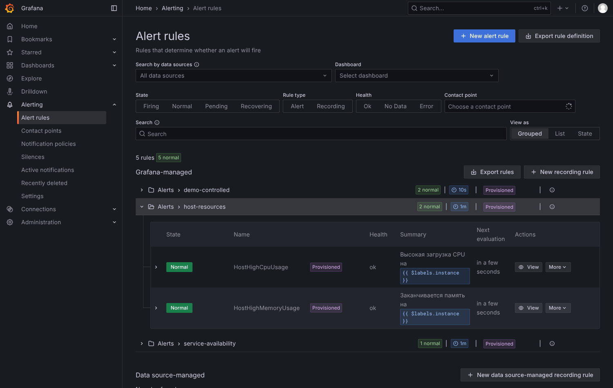
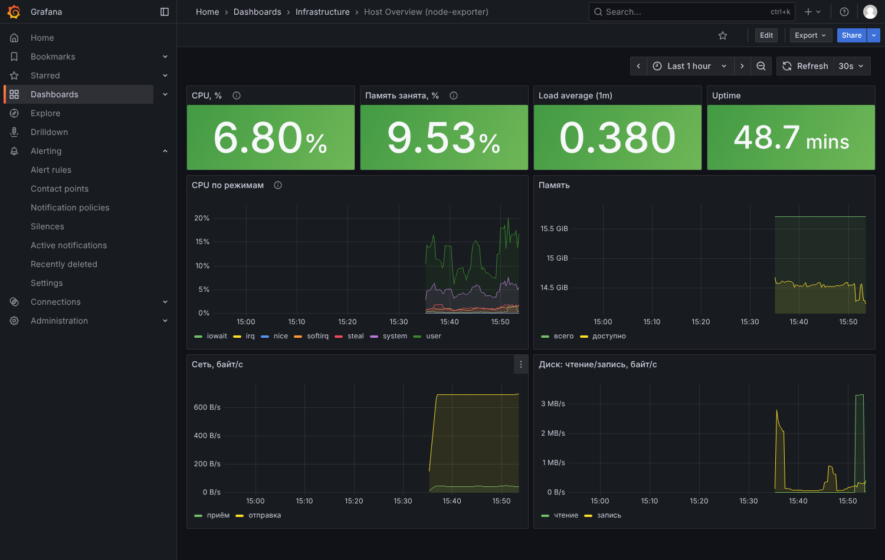

# 03. Первый `terraform apply`

Стенд работает, а Grafana пустая. Сейчас Terraform создаст в ней всё, что описано в репозитории.

Предварительно стенд должен быть запущен (`make up`), а файл `.secrets/terraform.env` — существовать (его создаёт bootstrap).

## Шаг 1. `init` — подготовка

```bash
make init
```
**Без make** (Git Bash / Linux / macOS):
```bash
set -a; . .secrets/terraform.env; set +a
terraform -chdir=terraform/envs/test init
```
**Без make (PowerShell):**
```powershell
. .\scripts\load-env.ps1
terraform -chdir=terraform/envs/test init
```
Если PowerShell отвечает «running scripts is disabled», разрешите скрипты **только для этого окна**: `Set-ExecutionPolicy -Scope Process -ExecutionPolicy Bypass`, и повторите.

Скрипт `load-env.ps1` читает `.secrets/terraform.env` и кладёт адреса и токены в переменные окружения текущего окна PowerShell. Делать это нужно в каждом новом окне.

`init` делает три вещи: скачивает провайдер `grafana/grafana` нужной версии (и проверяет его по `.terraform.lock.hcl`), подключает модули и подключается к хранилищу state в MinIO.

**Ожидаемый вывод (фрагмент):**
```
Initializing the backend...
Initializing modules...
- access in ../../modules/access
- alert_rules in ../../modules/alert-rules
...
Initializing provider plugins...
- Reusing previous version of grafana/grafana from the dependency lock file
- Installing grafana/grafana v4.49.0...
Terraform has been successfully initialized!
```
Значит, всё хорошо.

| Если вывод другой | Что делать |
|---|---|
| `Failed to query available provider packages ... registry.terraform.io` | Нет доступа к реестру Terraform (интернет/прокси). Проверьте сеть; в корпоративной сети нужен зеркальный реестр. |
| `Error refreshing state ... connection refused` / `dial tcp 127.0.0.1:9000` | MinIO не запущен. `make ps`, `make up`. |
| `Unsupported Terraform Core version` | Установлен Terraform старше 1.11. Обновите (см. [01](01-prerequisites.md)). |
| `The cached package ... does not match any of the checksums` | Lock-файл не содержит хешей для вашей платформы. Выполните `make lock` и закоммитьте изменённый `.terraform.lock.hcl`. |

## Шаг 2. `plan` — что будет создано

```bash
make plan
```
(без make: `terraform -chdir=terraform/envs/test plan`, переменные окружения загружены, как выше)

Terraform сравнит код с реальностью и напечатает список. Каждый ресурс отмечен значком:
* `+` — будет **создан**;
* `~` — будет **изменён**;
* `-` — будет **удалён**;
* `-/+` — будет **пересоздан** (удалён и создан заново).

Для чистой Grafana в конце будет:
```
Plan: 21 to add, 0 to change, 0 to destroy.
```
Читать весь план не обязательно, но просмотрите список строк `# module.… will be created`. Вы увидите ровно то, что написано в репозитории.

## Шаг 3. `apply` — применить

```bash
make apply
```
(без make: `terraform -chdir=terraform/envs/test apply`)

Terraform ещё раз покажет план и спросит:
```
Do you want to perform these actions?
  Enter a value:
```
Введите `yes` и нажмите Enter. (`AUTO=1 make apply` пропускает вопрос — пользуйтесь осознанно.)

**Ожидаемый финал:**
```
Apply complete! Resources: 21 added, 0 changed, 0 destroyed.

Outputs:

alert_rule_count = 5
alert_rule_groups = {
  "demo-controlled.yaml" = "demo-controlled"
  "host-resources.yaml" = "host-resources"
  "service-availability.yaml" = "service-availability"
}
contact_points = [
  "critical-webhook",
  "team-webhook",
]
dashboard_uids = {
  "Demo/stand-demo.json" = "stand-demo"
  "Infrastructure/host-overview.json" = "host-overview"
}
datasource_uid = "prometheus-main"
```

## Шаг 4. Проверка: идемпотентность

Выполните `make plan` ещё раз. Ожидаемо:
```
No changes. Your infrastructure matches the configuration.
```
Это важнейшее свойство: **если код не менялся, Terraform ничего не делает**. Если вместо этого он снова что-то собирается менять — это тревожный знак (см. [08-troubleshooting.md](08-troubleshooting.md)).

Дополнительно запустите автоматическую проверку «всё ли из Git есть в Grafana»:
```bash
make smoke
```
(без make: `docker compose run --rm tools python smoke.py`)

Ожидаемо: десятки строк `✅` и итог `Итог: 24/24 проверок пройдено`.

## Что создалось и где это найти в UI

Откройте http://localhost:3000 (`admin` / `admin12345`).

| Что создано | Код | Где смотреть в Grafana |
|---|---|---|
| Датасорс **Prometheus** (`uid = prometheus-main`, по умолчанию) | `modules/datasource-prometheus` | **Connections → Data sources**. Откройте его → внизу кнопка **Save & test** → «Successfully queried the Prometheus API». |
| Папки **Demo**, **Infrastructure** | `modules/dashboards` (имена подкаталогов `dashboards/`) | **Dashboards** |
| Дашборды **Host Overview**, **Stand: цели и тестовая метрика** | `dashboards/*/*.json` | **Dashboards → Infrastructure / Demo** |
| Папка **Alerts** и 3 группы правил (5 алертов) | `alerts/*.yaml`, `modules/alert-rules` | **Alerting → Alert rules**. Группы: `host-resources`, `service-availability`, `demo-controlled`. |
| Contact points **team-webhook**, **critical-webhook** | `modules/notifications` | **Alerting → Contact points**. Там же есть `email receiver` — это встроенная точка самой Grafana, Terraform её не трогает. |
| Notification policy: корень → `team-webhook`; `severity=critical` → `critical-webhook`; `severity=info` → `team-webhook` с mute timing | `modules/notifications` | **Alerting → Notification policies** |
| Mute timing **nightly-maintenance** (01:00–03:00 UTC) | `modules/notifications` | **Alerting → Notification policies → вкладка Time intervals** (в UI mute timing называется «time interval») |
| Шаблон **aac** | `modules/notifications/templates/aac.tmpl` | **Alerting → Contact points → вкладка Notification Templates** |
| Команда **platform** + права на папки | `modules/access` | **Administration → Users and access → Teams**; права: у папки меню **Manage permissions** |
| State | — | MinIO http://localhost:9001 → бакет `tfstate` → `envs/test/terraform.tfstate` |

Чего в Terraform **нет**: service account `terraform` и его токен — их создал `bootstrap` (иначе Terraform нечем было бы авторизоваться). Посмотреть: **Administration → Users and access → Service accounts**.

> Названия пунктов меню проверены на Grafana 12.2.0 (через headless-браузер). В других версиях они могут отличаться — тогда используйте поиск Grafana (Ctrl+K).

## Посмотрите алерты в работе

В **Alerting → Alert rules** все 5 правил должны быть в состоянии **Normal**, а у каждой группы — фиолетовый значок **Provisioned** (правило создано кодом и в UI не правится):



Примерно так должен выглядеть дашборд Host Overview (данные у вас будут другими):



Все 5 правил должны быть в состоянии **Normal**. Если у какого-то `Error` — откройте его, там будет причина (чаще всего Prometheus ещё не успел собрать данные; подождите минуту).

Теперь можно запустить `make alert-fire` — см. [04-tutorial-add-alert.md](04-tutorial-add-alert.md).
