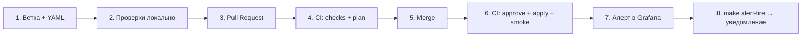

# 04. Туториал: добавляем алерт через YAML

Цель: пройти **весь путь** изменения — от YAML-файла до уведомления в приёмнике вебхуков.



Мы добавим алерт `MyFirstAlert`: «если тестовая метрика больше 30 — предупреждение». Тестовая метрика управляется командой, поэтому срабатывание легко проверить.

## Прежде чем начать: как устроен файл алертов

Откройте `alerts/demo-controlled.yaml`. Один файл = одна **группа правил**:

```yaml
group: demo-controlled     # имя группы в Grafana
interval: 10s              # как часто проверять правила группы
rules:
  - name: DemoControlledTestAlert           # имя алерта (уникальное)
    expr: 'max(demo_test_value)'            # PromQL-запрос
    operator: gt                            # gt = "больше", lt = "меньше"
    threshold: 50                           # порог
    for: 20s                                # сколько должно держаться, чтобы стать Firing
    severity: warning                       # critical | warning | info
    summary: "Тестовый алерт: ..."          # короткий заголовок
    description: "..."                      # подробности (необязательно)
    runbook_url: https://example.org/...    # ссылка на инструкцию (необязательно)
    labels:                                 # свои метки (необязательно)
      team: demo
```

Обязательные поля: `name`, `expr`, `threshold`, `severity`, `summary`. Остальное имеет значения по умолчанию (`operator: gt`, `for: 5m`, интервал группы `1m`).

**Как Grafana проверяет алерт.** Каждые `interval` она выполняет запрос `expr` (шаг A), сводит результат к одному числу (шаг B, «последнее значение») и сравнивает с порогом (шаг C). Если условие выполнено, алерт становится **Pending**. Если оно держится дольше `for` — **Firing**, и отправляется уведомление. Поэтому реальное время срабатывания — это примерно `interval + for`.

**Как выбирается получатель.** Уведомление идёт по метке `severity`: `critical` → `critical-webhook`, всё остальное → `team-webhook` (настроено в `terraform/envs/test/main.tf`).

## Шаг 1. Создайте ветку и файл

```bash
git switch -c add-my-first-alert
```
Создайте файл `alerts/my-team.yaml`:

```yaml
# Моя первая группа алертов
group: my-team
interval: 10s

rules:
  - name: MyFirstAlert
    expr: 'max(demo_test_value)'
    operator: gt
    threshold: 30
    for: 20s
    severity: warning
    summary: "Мой первый алерт: demo_test_value = {{ $values.B.Value }}"
    description: "Значение тестовой метрики превысило 30."
    runbook_url: https://example.org/runbooks/my-first-alert
    labels:
      team: my-team
```

> В YAML отступы — **только пробелы** (по 2 на уровень). Если выражение содержит кавычки `"`, оборачивайте его в одинарные `'...'`, как в примерах.

## Шаг 2. Проверьте локально

```bash
make validate
```
Эта команда ничего не меняет в Grafana. Она запускает форматирование, `terraform validate`, проверку дашбордов и **юнит-тесты модуля алертов** — они проверяют, в том числе, ваш YAML. Ожидаемо — в конце `Success! 7 passed, 0 failed.`

Теперь посмотрите, что изменится в Grafana:
```bash
make plan
```
Ожидаемые строки в плане:
```
  # module.alert_rules.grafana_rule_group.this["my-team.yaml"] will be created
  # module.alert_rules.terraform_data.validate["my-team.yaml"] will be created
Plan: 2 to add, 0 to change, 0 to destroy.
```
(`terraform_data.validate` — служебный ресурс, который проверяет ваш YAML; в Grafana он ничего не создаёт.)

Если вместо плана — ошибка `Resource precondition failed`, читайте **нижние строки** сообщения — там по-русски написано, что не так в файле:
```
Файл my-team.yaml: поле severity должно быть одним из: critical, warning, info. Проверьте правила: MyFirstAlert.
```
Исправьте и повторите. Примеры ошибок — в [08-troubleshooting.md](08-troubleshooting.md) и в упражнении 5.

## Шаг 3. Коммит и Pull Request

```bash
git add alerts/my-team.yaml
git commit -m "Add MyFirstAlert: warning при demo_test_value > 30"
git push -u origin add-my-first-alert
```
В GitHub откройте Pull Request в ветку `main`.

## Шаг 4. Что делает CI на Pull Request

Откройте вкладку **Checks** вашего PR. Запустятся (см. `.github/workflows/pr-checks.yml`):

| Проверка | Что проверяет | Если красная |
|---|---|---|
| `terraform fmt -check` | форматирование `.tf` | `make fmt`, закоммитить |
| `terraform validate` | синтаксис Terraform | читать сообщение, оно указывает файл и строку |
| `tflint` | устаревший/подозрительный Terraform-код | читать сообщение |
| `yamllint (alerts/)` | синтаксис и стиль YAML | обычно отступы или лишние пробелы |
| `Validate dashboards` | JSON дашбордов | см. [05](05-tutorial-add-dashboard.md) |
| `terraform test (alert-rules)` | смысл YAML-алертов: severity, порог-число, формат `for`... | читать сообщение |
| `terraform plan (stand)` | сухой прогон против Grafana; результат — **комментарий в PR** | ошибка доступа к Grafana → см. [06](06-ci-setup.md) |

В комментарии `Terraform plan` проверьте, что изменений **ровно столько, сколько вы ожидали**: у нас — только создание группы `my-team`. Если в плане есть чужие изменения (`~ update`, `- destroy`) — остановитесь и разберитесь, откуда они (возможно, drift — см. [07](07-drift-and-rules.md)).

Попросите коллегу сделать ревью.

## Шаг 5. Merge

Когда проверки зелёные, а ревьюер нажал Approve — **Squash and merge** (или как принято в команде).

## Шаг 6. Что делает CI после merge

Запускается `.github/workflows/apply.yml`:

1. job `Plan` показывает план в Summary запуска;
2. job `Apply + smoke test` ждёт вашего **ручного подтверждения** (Environment `test-stand`, см. [06](06-ci-setup.md)). Нажмите **Review deployments → Approve and deploy**;
3. выполняется `terraform apply`, затем `scripts/smoke.py` проверяет, что правило `MyFirstAlert` реально появилось в Grafana и защищено от ручных правок.

Если CI на вашей машине не настроен — примените вручную тем же способом, как это делает CI: `make apply`.

## Шаг 7. Найдите алерт в Grafana

http://localhost:3000 → **Alerting → Alert rules** → папка **Alerts** → группа **my-team** → `MyFirstAlert`, состояние **Normal**.

Откройте его: вы увидите запрос, порог, метки (`severity=warning`, `team=my-team`) и аннотации. У правила пометка **Provisioned**, а вместо кнопки *Edit* — только *View*: правило создано Terraform и в UI не правится (проверено на скриншотах Grafana 12.2.0 и через API — попытка изменить такое правило «как из UI» отклоняется, см. [07](07-drift-and-rules.md)).

Проверьте автоматически: `make smoke` — в списке появятся две строки про `MyFirstAlert`.

## Шаг 8. Вызовите срабатывание

```bash
make alert-fire
```
(без make: `docker compose run --rm tools python alert_e2e.py fire`)

Ожидаемый вывод (время будет немного отличаться):
```
▶ Поднимаем demo_test_value до 100
[    0s] 🔔 DemoControlledTestAlert: — → inactive
[   12s] 🔔 DemoControlledTestAlert: inactive → pending
[   30s] 🔔 DemoControlledTestAlert: pending → firing
[   33s] 📨 вебхук (aaaa…): DemoControlledTestAlert firing
   ✅ текст уведомления собран из нашего шаблона (aac.message)
   ✅ метка severity=warning и аннотация summary на месте
✔ Готово за 33с.
```
Скрипт следит за встроенным тестовым алертом `DemoControlledTestAlert`. Ваш `MyFirstAlert` реагирует на ту же метрику (100 > 30), так что он тоже срабатывает.

Теперь откройте приёмник: http://localhost:8081/s/aaaaaaaa-aaaa-4aaa-8aaa-aaaaaaaaaaaa

В списке слева появились запросы `POST`. Откройте запрос про `MyFirstAlert` и посмотрите **Body**:
* `title` — заголовок: `[FIRING:1] MyFirstAlert Alerts (warning my-team)`;
* `message` — текст из нашего шаблона `aac.message`;
* `alerts[0].labels` и `alerts[0].annotations` — все метки и аннотации вашего YAML, включая `runbook_url`;
* `alerts[0].status` — `firing`.

Это и есть «уведомление дошло, со всем содержимым».

Теперь снимите алерт:
```bash
make alert-resolve
```
Ожидаемо: состояния уходят в `Normal`, в приёмнике появляется запрос с `"status": "resolved"` (≈ 30 секунд).

## Если что-то пошло не так

| Симптом | Что проверить |
|---|---|
| Алерт висит в `Pending` дольше ожидаемого | Время срабатывания ≈ `interval + for` (у нас 10 с + 20 с + запаздывание скрейпа до 15 с). Для группы с `interval: 1m` и `for: 5m` — до 6 минут. |
| Алерт `Firing`, а в приёмнике пусто | Подождите `group_wait` (5 с на стенде). Проверьте **Alerting → Notification policies**: нет ли активного mute timing; смотрите **Alerting → Contact points → team-webhook → Test** — если тест не доходит, проблема в адресе. |
| В состоянии алерта `Error` / `NoData` | Откройте алерт: ошибка запроса к Prometheus (проверьте `expr` на http://localhost:9090/graph) или Prometheus недоступен. |
| `make alert-fire` ждёт и падает по таймауту `ТАЙМАУТ` | Проверьте `make ps`, что `grafana`/`webhook` healthy, и что `make smoke` зелёный (возможно, `apply` не выполнялся). |

## Уборка

Чтобы убрать пример: удалите `alerts/my-team.yaml`, закоммитьте, `make plan` покажет `destroy` группы, `make apply` её удалит.

Дальше: [05-tutorial-add-dashboard.md](05-tutorial-add-dashboard.md).
