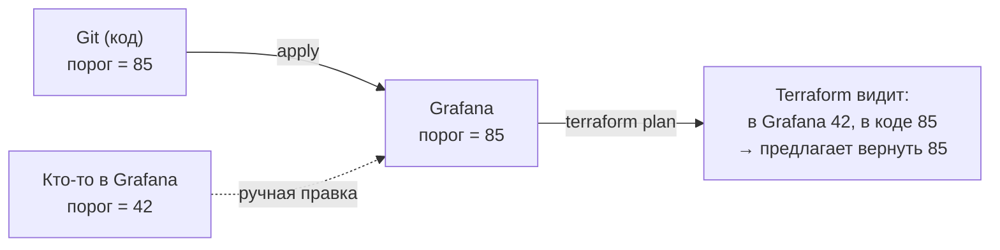

# 07. Почему нельзя править руками в UI: drift и provenance

## Главное правило

> **Всё, что описано в репозитории, меняется только через Git.** Правка «быстренько в интерфейсе» либо невозможна (мы её заблокировали), либо будет **затёрта** при следующем `terraform apply`, либо обнаружена как **drift**.

Почему так: если в Grafana можно править руками, то «источник правды» больше не Git. Через месяц никто не знает, какая версия алерта настоящая, а следующий `apply` молча откатит чью-то срочную правку.

## Что такое drift

**Drift (дрейф)** — расхождение между кодом и реальной Grafana.



Terraform при каждом `plan` **читает реальное состояние Grafana** и сравнивает с кодом. Любая разница — drift, и `plan` покажет её как изменение, которое нужно сделать, чтобы вернуть как в коде.

## Что защищено от правки руками, а что нет (честно)

В Grafana есть пометка **provenance** («происхождение»). Если объект создан через API/Terraform, у него `provenance = api`, и **интерфейс не даёт его править**. Но она есть **не у всех** типов объектов:

| Объект | Защита в UI | Как у нас защищено | Drift ловится? |
|---|---|---|---|
| Правила алертов | ✅ provenance: в списке значок **Provisioned**, вместо *Edit* — только *View*; ruler API (его использует UI) отвечает 400 — даже админу | provenance | ✅ |
| Contact points, notification policy, mute timings, шаблоны | ✅ provenance (значок **Provisioned** на скриншотах) | provenance | ✅ |
| **Дашборды** | ❌ **Нет.** Для дашбордов, созданных через API, Grafana не ставит provenance | Права папки: **Editor и Viewer — только View**. Но **админ организации по-прежнему может править** | ✅ (по содержимому JSON) |
| **Датасорс** | ❌ Нет | Править датасорсы может только админ (нужны права `datasources:write`) | ✅ |
| Папки | ❌ Нет | Права папок | ✅ |

Что это значит на практике:

* **Алерты и уведомления** защищены надёжно: через UI не поменять.
* **Дашборды** защищены только правами. Обычный пользователь не сохранит их (HTTP 403 — проверено), но администратор может и **затрёт чужую работу себе же**: при следующем `apply` правка исчезнет. Поэтому админов нужно предупредить правилом из этого документа, а drift detection (раз в 6 часов) поймает нарушителя.
* От человека, у которого есть токен service account или пароль админа, **provenance не защищает**: через тот же provisioning API (которым пользуется Terraform) правило поменять можно. Provenance защищает от случайных кликов в интерфейсе, а не от злого умысла. Для настоящей защиты ограничивайте, у кого есть админские права и токены.

## Как проверить защиту руками

### Через UI

1. Grafana → **Alerting → Alert rules**: у групп (`host-resources` и др.) фиолетовый значок **Provisioned**; раскройте группу — у правил кнопка **View** (а не Edit), в меню **More** нет *Edit*/*Delete*. См. скриншот в [03-first-apply.md](03-first-apply.md).
2. **Alerting → Contact points**: у `team-webhook` значок **Provisioned**; **Alerting → Notification policies**: значок **Provisioned** у дерева маршрутов и на вкладке **Time intervals** у `nightly-maintenance`.
3. **Dashboards → Infrastructure → Host Overview**: у администратора кнопка **Edit** есть (дашборды provenance не защищает!). Чтобы увидеть ограничение, войдите обычным пользователем с ролью Editor: он может открыть дашборд, но не сохранить изменения.

### Через скрипт (то же, что делает UI)

```bash
make drift-rule-ui
```
(без make: `docker compose run --rm tools python drift.py rule-ui`)

Ожидаемый вывод:
```
✅ Grafana ОТКАЗАЛА (HTTP 400): failed to update rule group: request affects resources created via provisioning API: alert rule group [{orgID: 1, namespaceUID: alerts-alerts, groupName: host-resources}]
   Так выглядит защита provenance: через UI правило, созданное Terraform, не поменять.
```
Скрипт повторяет запрос, который отправляет интерфейс при сохранении правила. Отказ — это и есть защита.

## Упражнение: создайте drift и поймайте его

Стенд поднят, `make apply` выполнен, `make plan` показывает `No changes`.

**1. Испортите стенд «руками»** (скрипты делают то же, что сделал бы человек через UI/API):
```bash
make drift-dashboard     # переименует дашборд Host Overview
make drift-datasource    # поменяет URL датасорса на неверный
make drift-rule          # поменяет `for` у правила HostHighCpuUsage на 42m
```
Ожидаемо — по строке на каждую: `дашборд: 200 переименован`, `датасорс: 200 Datasource updated`, `правило: 200 for изменён на 42m`.

(Заметьте последствие: пока датасорс сломан, **все алерты уходят в `Error`** — они не могут обратиться к Prometheus. Это типичный эффект «мелкой ручной правки».)

**2. Обнаружьте drift:**
```bash
make plan
```
Ожидаемо — три изменения вида `~`:
```
  # module.alert_rules.grafana_rule_group.this["host-resources.yaml"] will be updated in-place
      ~ rule {
          ~ for                             = "42m0s" -> "5m"
  # module.dashboards.grafana_dashboard.this["Infrastructure/host-overview.json"] will be updated in-place
              ~ title         = "Host Overview (node-exporter) (EDITED BY HAND)" -> "Host Overview (node-exporter)"
  # module.prometheus.grafana_data_source.prometheus will be updated in-place
      ~ url                 = "http://prometheus:9999" -> "http://prometheus:9090"
Plan: 0 to add, 3 to change, 0 to destroy.
```
Читать план нужно так: **слева — что сейчас в Grafana, справа — что в коде** (`было -> будет`). `plan` предлагает вернуть Grafana к коду.

В CI это делает job «Drift detection» (`terraform plan -detailed-exitcode`). Коды возврата:

| Код | Значение |
|---|---|
| 0 | расхождений нет |
| 1 | ошибка (нет доступа, битый конфиг…) |
| 2 | **есть расхождение — drift**. Job краснеет |

Проверить код руками: `terraform -chdir=terraform/envs/test plan -detailed-exitcode; echo $?` (с загруженными переменными окружения; в PowerShell — `$LASTEXITCODE`). У нас проверено: после трёх ручных правок код возврата `2`, после `apply` — `0`.

**3. Восстановитесь:**

Вариант А — ручная правка была **ошибкой**: верните как в коде.
```bash
make apply
```
Ожидаемо: `Apply complete! Resources: 0 added, 3 changed, 0 destroyed.` и затем `make plan` → `No changes`.

Вариант Б — ручная правка была **нужной**: перенесите её в код (YAML/JSON/`.tf`), сделайте PR, и только после merge `apply`. Если сделать `apply` сразу, правка будет потеряна.

## Другие ситуации

| Ситуация | Что делать |
|---|---|
| Кто-то **удалил** объект в Grafana (папку, дашборд) | `plan` покажет `+ create` — `apply` создаст заново |
| Кто-то **создал** в Grafana свой объект (например, алерт в своей папке) | Terraform о нём не знает и **не трогает**. Исключение — notification policy (одна на всю организацию): её Terraform перезаписывает целиком |
| Хотите, чтобы Terraform «усыновил» уже существующий объект | `terraform import …` (см. страницы Import в [документации провайдера](https://registry.terraform.io/providers/grafana/grafana/latest/docs)); сначала опишите его в коде |
| Объект нужно **убрать из-под управления Terraform**, но не удалять из Grafana | `terraform state rm <адрес>` (осторожно, спросите опытного коллегу), затем удалите описание из кода |
| Потеряли state | Не паникуйте: бакет MinIO включён с версионированием — можно восстановить предыдущую версию файла `envs/test/terraform.tfstate` в консоли MinIO. Без state Terraform попытается создать всё заново и получит конфликты (`409`/`already exists`) — тогда понадобится `terraform import` |
| `apply` упал на середине | Просто повторите `make plan` и `make apply`: Terraform доделает остальное. Не удаляйте state и не правьте его руками |
| State «завис» в блокировке (`Error acquiring the state lock`) | Убедитесь, что `apply` больше нигде не идёт. Затем `terraform -chdir=terraform/envs/test force-unlock <ID из сообщения>` |

## Как работает блокировка state (демонстрация)

Блокировка не даёт двум людям одновременно менять Grafana. Мы проверили: два одновременных `terraform apply` → второй получил

```
Error: Error acquiring the state lock
...
PreconditionFailed: At least one of the pre-conditions you specified did not hold
Lock Info:
  ID:        04b3cb2f-9d18-b2e0-b447-99402dba68ae
  Path:      tfstate/envs/test/terraform.tfstate
  Operation: OperationTypeApply
  Who:       root@vm
```
То есть Terraform создал рядом со state файл блокировки (`.tflock`) условной записью (`use_lockfile = true`) — и второй запрос отбит. В CI тот же эффект достигается ещё и `concurrency` у workflow.

## Чек-лист: «хочу что-то поменять в Grafana»

1. Это есть в репозитории? (`alerts/`, `dashboards/`, `terraform/`) → **правьте файл**, делайте PR.
2. Хочется поэкспериментировать мышкой? → в **своей песочнице** (папка Sandbox, созданная вручную) и экспортируйте результат в Git ([05](05-tutorial-add-dashboard.md)).
3. Срочно, прямо сейчас горит? → сделайте правку в Git по ускоренному ревью; ручная правка в обход Git будет откачена и всё равно придётся делать PR.
